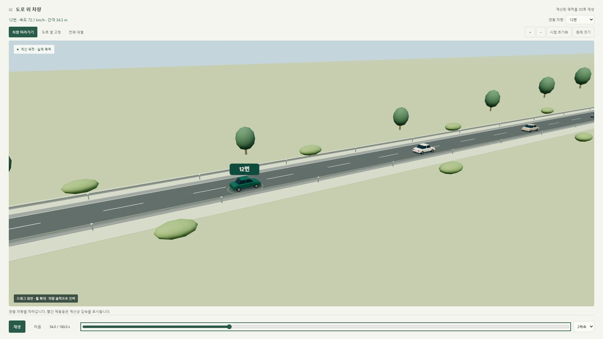

# Traffic Wave Lab · 교통 파동 분석기

Interactive 3D traffic wave simulator with car-following models and trajectory analysis.

`traffic-wave-lab.html`을 브라우저에서 열면 됩니다. 설치·서버·인터넷 연결 없이 실행합니다.



## 기능

- 선두차의 반복 감속·가속 또는 단발 감속에 대한 후속 차량 계산
- 반응시간, 희망 시간간격, 차량 수, 가감속 성향 등 조절
- 차량 대열 재생·배속·시간 이동, 속도 열지도, 속도 및 차간거리 그래프
- 도로·자동차 3D 보기: 차량 추적, 도로 옆 고정 시점, 전체 대열, 회전·확대·전체 화면
- 차량별 수치, 결과 CSV(위치·속도·간격·가속도)와 재현용 설정 JSON 저장
- 실측 CSV 검증, 공통 구간 정렬·보간, 계산/관측 비교와 후속 차량 RMSE
- 반응시간·희망 시간간격의 제한된 격자 탐색 추정

실제 관측 자료가 포함되어 있지 않습니다. ‘합성 예제’와 CSV 양식의 행은 기능 확인용 가상 자료입니다.

## 3D 보기

위치·속도·차장을 기존 계산값 그대로 사용합니다. 3D 표시는 교통 모델을 변경하지 않습니다. 자동차와 도로는 절차적으로 만든 시각 모델이며 실사 영상이나 특정 도로의 복원 결과가 아닙니다.

- `차량 따라가기`: 관찰 차량 근처로 카메라가 함께 이동합니다.
- `도로 옆 고정`: 대열이 카메라 앞을 지나갑니다. 모두 지나갔으면 `시점 초기화`로 현재 대열 근처에 카메라를 옮깁니다.
- `전체 대열`: 전체 차량을 한눈에 봅니다.
- 드래그로 시점을 회전하고 휠/확대·축소 버튼으로 거리를 조절합니다. 차량 클릭 또는 관찰 차량 선택 상자를 사용합니다.
- 제동등은 계산 가속도가 음수인 감속 상태를 표시합니다. 관측 차량은 2D 대열과 점선 그래프에 표시됩니다.
- WebGL을 지원하지 않으면 3D만 사용할 수 없으며 2D와 계산 기능은 유지됩니다.

Three.js 0.160.1(MIT)을 로컬로 포함합니다. 출처 및 라이선스: `vendor/THREE-LICENSE.txt`. 단일 HTML에도 라이선스 전문을 포함하므로 인터넷 없이 실행할 수 있습니다.

## 실측 CSV

필수 헤더: `time_s,vehicle_id,position_m,speed_kmh`

- 모든 차량은 동일한 시계와 좌표계를 사용해야 합니다.
- 위치는 진행 방향으로 증가하는 앞범퍼 좌표(m), 속도는 km/h입니다.
- 동일 차로에서 차량 순서가 유지되는 구간만 지원하며 차장은 설정값을 공통 사용합니다.
- 최소 2대, 최대 30대, 차량당 3점 이상. 공통 구간 1~300초, 관측 간격 최대 2초.
- 최대 12 MB / 150,000행. CSV UTF-8 권장. 위치·속도는 필수입니다.
- 공통 구간을 0.2초로 선형 보간하고 시간·위치를 공통 시작 기준으로 이동합니다.
- 내보낸 CSV의 시간은 상대시간, 위치는 시작 시점 선두 앞범퍼 기준입니다. 원본 시간 범위는 설정 JSON의 dataSummary에 보존됩니다.

## 모델과 해석

IDM 가속도 식의 모든 상태 입력에 명시적 반응 지연을 추가한 균질 단일 차로 모델입니다. 반응 지연은 원래 IDM의 기본 매개변수가 아닙니다. 차량/운전자 계수는 동일하며 차로 변경은 없습니다. 가상 대열은 평형 상태에서 출발하고, 8초 후 선두차가 속도를 변경합니다. 실측에서는 선두 궤적과 각 뒤차의 관측 초기값을 사용합니다. 시작 이전 지연 이력은 일정 속도로 연장합니다.

중점 가속도와 탄도 위치 갱신을 사용합니다. 기본 계산 간격 0.05초, 기록 간격 0.2초, 최대 감속 9 m/s². 정지 후 후진하지 않으며, 충돌 검출 시 최초 접촉에서 계산을 중단합니다. 위치를 강제로 재배열하여 충돌을 숨기지 않습니다.

속도 변동비는 유한 계산구간의 끝차 최대-최소 속도를 선두의 최대-최소 속도로 나눈 값입니다. 엄밀한 선형 안정성이나 현장의 파동 전파속도를 직접 추정한 값은 아닙니다. 최대/최소 지표는 계산점, 그래프·내보내기는 기록점 기준입니다.

추정은 다른 계수를 고정하고 τ와 T 후보들의 뒤차 속도 RMSE를 비교합니다. 같은 자료에 대한 적합도이며 독립적인 검증이나 신뢰구간을 제공하지 않습니다. 실측 연구에 사용할 때는 좌표·동기화·관측 잡음의 확인과 별도 검증 자료가 필요합니다.

근거: [IDM 공식 모델 및 적분 설명](https://mtreiber.de/MicroApplet/IDM.html), [원 논문](https://arxiv.org/abs/cond-mat/0002177), [반응 지연과 안정성 확장](https://www.mtreiber.de/publications/StabilityIFAC06.pdf).

## 소스 수정과 검증

Node.js가 설치된 환경에서:

```powershell
node --test model.test.js data.test.js
node build.js
```

`model.js`는 계산 엔진, `data.js`는 CSV·비교·추정, `scene3d.js`는 3D 장면, `app.js`는 화면 연결 코드입니다. HTML/CSS/JS 수정 후 build.js를 실행하면 단일 파일을 다시 만듭니다.
